<picture>
  <source media="(prefers-color-scheme: dark)" srcset="https://raw.githubusercontent.com/mert1026/mert1026/gitascii/profiles/default/dark.svg?v=2c7e6b1">
  <source media="(prefers-color-scheme: light)" srcset="https://raw.githubusercontent.com/mert1026/mert1026/gitascii/profiles/default/light.svg?v=2c7e6b1">
  
</picture>
